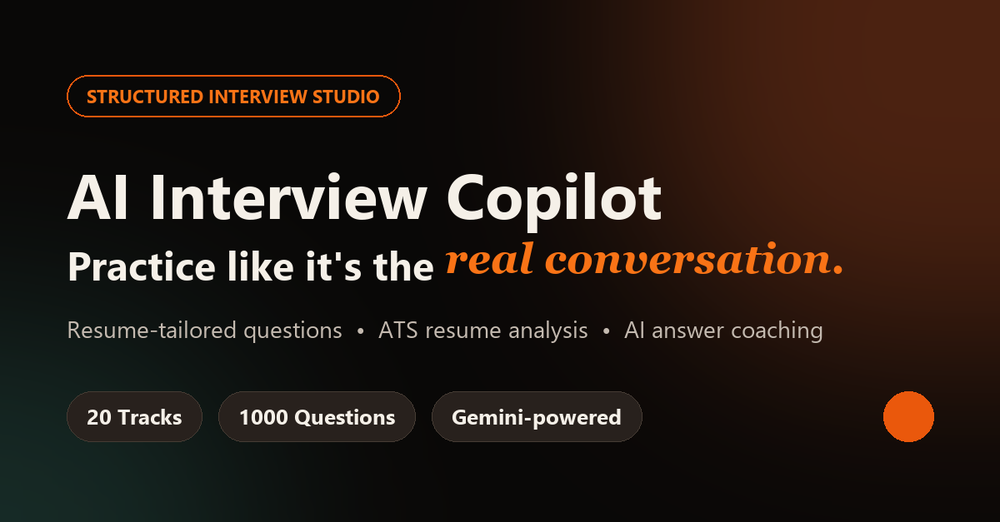

# AI Interview Copilot

**Practice like it's the real conversation.** Upload your resume, get ATS-style feedback, and practice timed interview drills with AI answer coaching.

**Live demo:** https://ai-interview-copilot-fsff.onrender.com

> Hosted on Render's free tier: the first visit after a quiet period can take ~50 seconds while the server wakes up.



## Features

- **Resume analysis**: upload a PDF or DOCX resume and get an ATS-style review (score, strengths, weaknesses, missing skills, suggestions), plus a skill match against an optional target role or job description.
- **Resume-tailored questions**: 10 questions generated from your own resume, ordered from beginner to advanced, each with a sample answer and hint.
- **Question bank**: 1000 questions across 20 tracks: AI & data roles (AI Engineer, ML, GenAI/RAG, MLOps, Data Science), software engineering (HTML, CSS, JavaScript, React, TypeScript, SQL, Python, Node.js, Git, DSA), and business & operations.
- **Timed practice**: 4 minutes per question, with bookmarks and a "missed questions" review list.
- **AI Answer Coach**: scores your answer out of 100 with feedback, strengths, weaknesses, suggestions, and an ideal answer, plus AI follow-up questions.
- **Progress tracking**: session history, average and best scores, and per-track accuracy.
- **Accounts and privacy**: sign-up and login, a profile page, and one-click deletion of your resume data or your whole account.

## Tech stack

| Layer | Tools |
|---|---|
| Backend | Python, Flask, Gunicorn |
| AI | Google Gemini (fast flash-lite models with automatic fallback across models), with an optional local Ollama fallback |
| Resume parsing | pdfplumber (PDF), built-in DOCX XML parsing |
| Database | PostgreSQL on Neon (production), SQLite (local development) |
| Frontend | Jinja templates, React 18, Framer Motion, Three.js, Lucide icons |
| Hosting | Render (Blueprint via `render.yaml`) |

## Security

- Passwords hashed with scrypt; never stored in plain text
- CSRF protection on every form and API call
- Per-IP rate limiting on login, sign-up, password reset, resume upload, and AI endpoints
- Upload validation by file type, magic bytes, and a 5 MB size limit
- Secure, HttpOnly, SameSite session cookies, plus `X-Frame-Options`, `nosniff`, and a referrer policy
- Hashed, 15-minute, one-time password-reset tokens

## Run locally

```bash
git clone https://github.com/revanthreddykonda777-source/ai-interview-copilot.git
cd ai-interview-copilot
python -m venv venv
venv\Scripts\activate          # macOS/Linux: source venv/bin/activate
pip install -r requirements.txt
```

Create a `.env` file in the project root:

```env
GOOGLE_API_KEY=your-gemini-api-key
```

Get a free key at https://aistudio.google.com/apikey. Then run:

```bash
python app.py
```

Open http://127.0.0.1:5000. The question bank is seeded automatically on the first run.

## Deploy your own (Render)

1. Fork this repo.
2. On [Render](https://render.com), choose **New → Blueprint** and select your fork. `render.yaml` sets everything up on the free plan.
3. Paste your `GOOGLE_API_KEY` and a Postgres `DATABASE_URL` (a free [Neon](https://neon.tech) database works) when prompted, then click **Deploy**. Without `DATABASE_URL` the app falls back to SQLite, which Render's free tier wipes on every restart.

## Project structure

```
app.py                  # entry point (gunicorn app:app)
backend/
  server.py             # Flask routes, auth, security, rate limiting
  database.py           # Postgres (DATABASE_URL) or SQLite connection layer
  db.py                 # schema and migrations
  ai/                   # Gemini client (multi-model fallback), Ollama fallback, router
  services/             # resume parsing, skill extraction, question generation, answer scoring
  scripts/              # question-bank seeding and admin tools
frontend/
  templates/            # Jinja pages
  static/               # CSS, JS (React components), images
render.yaml, Procfile   # deployment config
```

## Known limitations

- Password-reset emails aren't sent yet; reset links appear in the server logs.
- The Gemini free tier allows only a few requests per minute, so heavy simultaneous use can fall back to basic, non-AI scoring.

## Author

**Konda Naga Revanth Kumar Reddy**: [GitHub](https://github.com/revanthreddykonda777-source) · [LinkedIn](https://linkedin.com/in/revanth-reddy-075)
